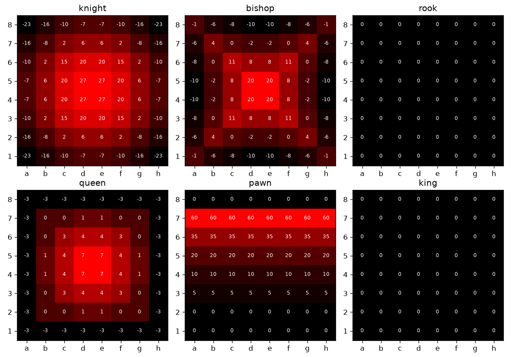

# Boberchik the chess engine
- build boberchik: go build -o boberchik ./cmd/engine
- play against boberchik if online: https://lichess.org/@/BoberchikBot

### Tests and Benches
- run tests: go test ./internal/chess
- run bench: go test -run '^$' -bench Perft -benchtime 3x ./internal/chess

benches:

| CPU | Go | suite | commit | nodes | Mnps |
|-----|----|------:|--------|------:|-----:|
| Apple M4 Pro | go1.27.1 darwin/arm64 | v1 | 8021a72 | 16046250 | 20.34 |

## PSTs

Mobility-based PSTs (generated by `tools/gen_pst.py`), used as a baseline for trained PSTs:

